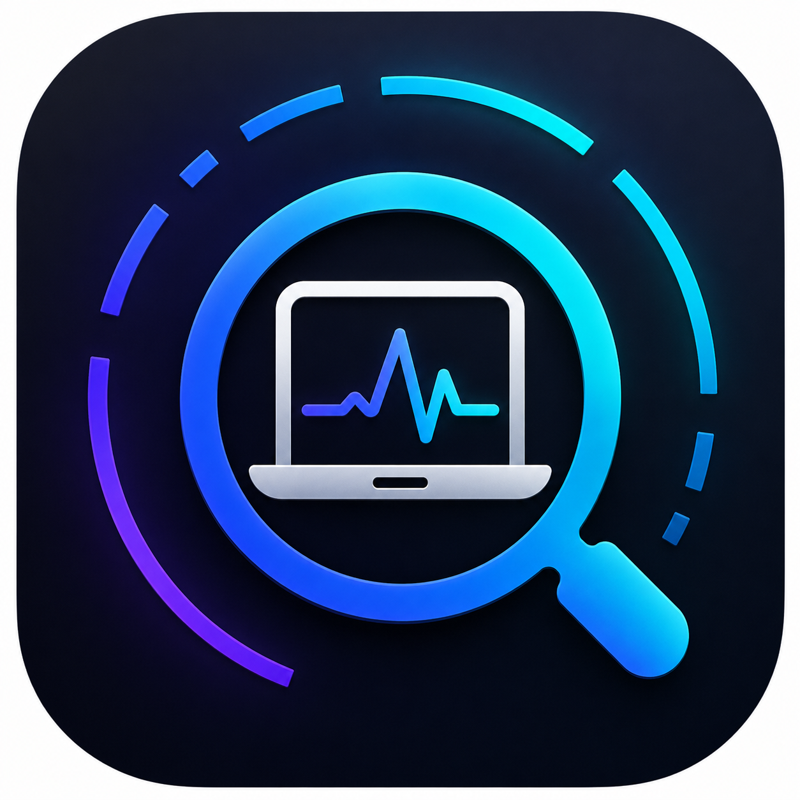

<div align="center">
  

  <h1>MacLens</h1>

  <p><strong>Know your Mac.</strong></p>

  <p>
    A native macOS app that gathers your Mac's hardware, battery, storage,<br>
    performance, and display details into one clean, readable dashboard.
  </p>

  <p>
    
    
    
    
    <a href="LICENSE"></a>
  </p>

  <p>
    <a href="#features">Features</a> &middot;
    <a href="#installation">Installation</a> &middot;
    <a href="#building-from-source">Building</a> &middot;
    <a href="#how-it-works">How it works</a> &middot;
    <a href="#license">License</a>
  </p>
</div>

<br>

## About

Instead of digging through System Settings, System Information, and Terminal, MacLens shows every important spec in a single window, with drill-downs for the things people actually care about: battery health, disk space, live CPU and memory load, and connected displays.

It is a small, dependency-free SwiftUI app. There is no Xcode project, no package manager, and no network access. Everything is read locally from your Mac.

## Features

| Section | What you get |
| :-- | :-- |
| **Overview** | Model, chip, performance and efficiency core layout, memory, macOS version and build, serial number, uptime, and computer name, with a hero banner and quick-glance stat tiles. |
| **Battery** | Cycle count, maximum-capacity health, condition, and current charge, plus electrical detail (temperature, voltage, amperage) and full-charge vs. design capacity in mAh. |
| **Storage** | Every volume with used, free, and total space and visual usage bars. The startup disk and internal vs. external drives are clearly flagged. |
| **Performance** | Live CPU load with per-core activity bars and a memory breakdown (app, wired, compressed, cached, swap), refreshed every second. |
| **Graphics** | GPU core count and Metal support, plus each connected display's resolution and refresh rate. |

### Also included

- **Real-time refresh.** CPU and memory update every second; battery, storage, and displays refresh every few seconds, so plugging in a drive or charger shows up without restarting the app.
- **Click to copy.** Click any value (serial number, model identifier, build number, and so on) to copy it to the clipboard.
- **Light, Dark, and Auto appearance.** Switch from the sidebar. Auto follows the system setting, and your choice is remembered between launches.
- **Private by design.** No analytics, no network calls, no data leaves your Mac.

## Requirements

- macOS 13 Ventura or later
- A Mac with Apple Silicon (the build targets `arm64`)
- Xcode or the Xcode Command Line Tools, only if you build from source

## Installation

### Download

Grab the latest signed and notarized `.dmg` from the [Releases page](https://github.com/bsamson00/MacLens/releases), open it, and drag **MacLens** into **Applications**. It opens with no Gatekeeper warning.

### Build it yourself

See [Building from source](#building-from-source) below. It takes one command.

## Building from source

MacLens compiles straight to a double-clickable app bundle with `swiftc`. No Xcode project is required.

```sh
git clone https://github.com/bsamson00/MacLens.git
cd MacLens
./build.sh
open build/MacLens.app
```

`build.sh` compiles every file in `Sources/`, generates the `.icns` app icon from `Assets/AppIcon.png`, assembles the bundle, and applies an ad-hoc code signature so it runs on your own machine.

### Packaging a DMG

```sh
brew install create-dmg
./make-dmg.sh
```

This produces `build/MacLens-<version>.dmg` with a styled drag-to-Applications window. The background image is rendered from `Assets/dmg-background.swift` each time. If a **Developer ID Application** certificate is in your keychain, the disk image is signed with it.

### Signing and notarizing for distribution

`notarize.sh` signs the app with your Developer ID and the hardened runtime, builds the DMG, submits it to Apple's notary service, and staples the ticket so it validates offline.

It needs a one-time credential profile stored in your keychain. Using an app-specific password:

```sh
xcrun notarytool store-credentials "maclens-notary" \
  --apple-id "you@example.com" --team-id "YOUR_TEAM_ID"
```

Or using an App Store Connect API key:

```sh
xcrun notarytool store-credentials "maclens-notary" \
  --key AuthKey_XXXX.p8 --key-id KEYID --issuer ISSUER-UUID
```

Then run:

```sh
./notarize.sh
```

Set `NOTARY_PROFILE` if you saved the profile under a different name. If you fork this project, update `TEAM_ID` in `notarize.sh` and `CFBundleIdentifier` in `Info.plist` to your own values.

## How it works

MacLens reads everything locally using tools and APIs that ship with macOS:

| Data | Source |
| :-- | :-- |
| Hardware, memory type, storage, displays, GPU | `system_profiler` (JSON output) |
| Battery cycles, capacity, temperature, voltage | `ioreg` (`AppleSmartBattery`) plus `system_profiler SPPowerDataType` |
| Live CPU load, per core | Mach `host_processor_info` |
| Live memory and swap | Mach `host_statistics64` and `sysctl vm.swapusage` |
| Model, core count, RAM fallback | `sysctl` |

Heavy collection runs on a background queue so the interface never blocks. Hardware specs are loaded once, while battery, storage, and display data is re-collected on a timer with overlapping refreshes coalesced.

## Project structure

```
MacLens/
├── Sources/
│   ├── App.swift             App entry point, sidebar, navigation, appearance
│   ├── Models.swift          Plain data models for each section
│   ├── SystemService.swift   Data collection and live metrics
│   ├── Shell.swift           Process, sysctl, and formatting helpers
│   └── Views/                One SwiftUI view per section, plus Theme and About
├── Assets/
│   ├── AppIcon.png           Source icon (1024 x 1024)
│   └── dmg-background.swift  Renders the DMG window background
├── Info.plist
├── build.sh                  Build the .app bundle
├── make-dmg.sh               Package a styled .dmg
└── notarize.sh               Sign, notarize, and staple for distribution
```

## Contributing

Issues and pull requests are welcome. For anything larger than a small fix, please open an issue first so we can talk it through. Keep changes dependency-free and in the style of the existing code.

## License

Released under the [MIT License](LICENSE).

## Author

**Brian Samson**<br>
[samson.zone](https://www.samson.zone) &middot; [brian@samson.zone](mailto:brian@samson.zone)
